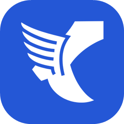
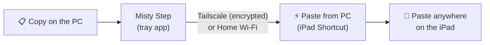

<div align="center">



# Misty Step

**Copy on your Windows PC. Paste on your iPad.**

A tiny tray app that hands the last text or image you copied to your iPad or iPhone, in one tap.

[](https://github.com/paulsonkantony/MistyStep/releases)
[](https://github.com/paulsonkantony/MistyStep/actions/workflows/build.yml)
[](LICENSE)


[**Download**](https://github.com/paulsonkantony/MistyStep/releases) · [Quick start](#quick-start) · [Privacy](docs/PRIVACY.md) · [Troubleshooting](docs/TROUBLESHOOTING.md)

</div>

---

## How it works



Misty Step sits in the notification area and keeps the last thing you copied: text, a link, a screenshot or an image file. When you run the **Paste from PC** Shortcut on the iPad, it fetches that item and puts it on the iPad's clipboard, ready to paste. Nothing goes through a cloud service: the iPad talks straight to your PC.

## Features

- **One tap on the iPad.** Run the Shortcut from the Home Screen, Control Center, the AssistiveTouch button, Spotlight or Siri, without leaving the app you're in.
- **Text, links and images.** Screenshots, images copied from a browser, and image files copied in Explorer. Big images are shrunk to fit.
- **Private by design.** Only paired devices can fetch, each with its own key. Password-manager copies are skipped. Items expire after 10 minutes (adjustable), and nothing is ever written to disk.
- **Works anywhere with Tailscale**, encrypted end to end, or on your home Wi-Fi.
- **You're in control.** Pause sharing, switch to Manual mode (share only when you press <kbd>Ctrl</kbd>+<kbd>Alt</kbd>+<kbd>C</kbd>), clear the shared item, and revoke devices.
- **Looks after itself.** Health checks with one-click firewall fixes, it recovers after sleep and network changes, and it can start with Windows.

## Quick start

1. **Install.** Download `MistyStep-<version>-x64-setup.exe` from [Releases](https://github.com/paulsonkantony/MistyStep/releases) (`arm64` for Windows on Arm) and run it. Install [Tailscale](https://tailscale.com/download) on the PC and the iPad, and sign in to both with the same account.
2. **Pair.** Misty Step opens a welcome window, then **Pair a device**. Scan the QR code with the iPad's Camera app. A page opens in Safari with a setup code.
3. **Create the Shortcut.** Follow the steps on that page (also in [`shortcut/BUILD.md`](shortcut/BUILD.md)) to build **Paste from PC** in Apple's Shortcuts app, with the setup code inside it. It takes about 15 minutes, once. Run it once and choose **Always Allow**.

Then: copy on the PC, tap **Paste from PC** on the iPad, and paste. 🎉

## Downloads

| File | What it is |
| --- | --- |
| `MistyStep-<version>-x64-setup.exe` | **Installer** for most PCs (recommended). Sets up the firewall, Start menu entry and uninstaller. |
| `MistyStep-<version>-arm64-setup.exe` | Installer for Windows on Arm. |
| `MistyStep-<version>-<arch>-portable.zip` | **Portable** version: unzip and run from any folder, settings stay in that folder. |
| `SHA256SUMS.txt` | Checksums to verify the downloads. |

Both bundle .NET, so nothing else is needed (about 55 MB).

> [!NOTE]
> The downloads are not code-signed, so Windows may show **"Windows protected your PC"**. Choose **More info**, then **Run anyway**. To check that a file is genuine, compare `Get-FileHash <file>` in PowerShell with `SHA256SUMS.txt` on the release page.

**Requirements:** Windows 11 (Windows 10 22H2 should work), an iPad or iPhone with the Shortcuts app, and Tailscale on both. Home Wi-Fi mode works without Tailscale, but only on a network Windows marks as Private, and it is not encrypted.

## Privacy

Everything stays on your PC and your own devices. Misty Step stores settings and hashes of device keys, never what you copy. It sends **no telemetry and no reports**. Its only internet request is an optional weekly check for a new version on GitHub, off unless you turn it on. Details: [`docs/PRIVACY.md`](docs/PRIVACY.md).

## About this project

> [!IMPORTANT]
> - **Built entirely with AI.** Every line of code and documentation was written with an AI assistant (Claude Code). I directed the work and tested it on my own PC and iPad.
> - **Made for my personal use.** I'm sharing it in case others find it useful.
> - **Provided as is.** There is no warranty and no promise of support, fixes or updates. I take no responsibility for any problem it causes. Use it at your own risk.
> - **No reports.** The app sends nothing to me or anyone else, and there is no way to submit reports.

## Troubleshooting

See [`docs/TROUBLESHOOTING.md`](docs/TROUBLESHOOTING.md), or open **Help and troubleshooting** from the tray menu: it runs the health checks and shows diagnostic details.

## Building from source

Needs the .NET 10 SDK, and [Inno Setup 6](https://jrsoftware.org/isinfo.php) for the installer.

```powershell
dotnet test --solution MistyStep.sln                                  # build and run all tests
powershell -ExecutionPolicy Bypass -File tools/build-release.ps1       # installers, zips and checksums in artifacts/
```

Pushing a tag such as `v1.0.0` runs the same build on GitHub and creates a draft release. The design and build plan are in [`plan/`](plan/).

## Credits

- **App icon:** ["Wingfoot"](https://game-icons.net/1x1/lorc/wingfoot.html) by [Lorc](https://lorcblog.blogspot.com), from [game-icons.net](https://game-icons.net), licensed under [CC BY 3.0](https://creativecommons.org/licenses/by/3.0/). Changes: the white artwork is placed on a blue rounded square and resized. The originals are in [`icon/`](icon/), and [`tools/make-icon.ps1`](tools/make-icon.ps1) builds the app's icon from them.
- **QR codes:** [QRCoder](https://github.com/codebude/QRCoder), MIT License. See [`THIRD-PARTY-NOTICES.md`](THIRD-PARTY-NOTICES.md).

Misty Step is released under the [MIT License](LICENSE).
